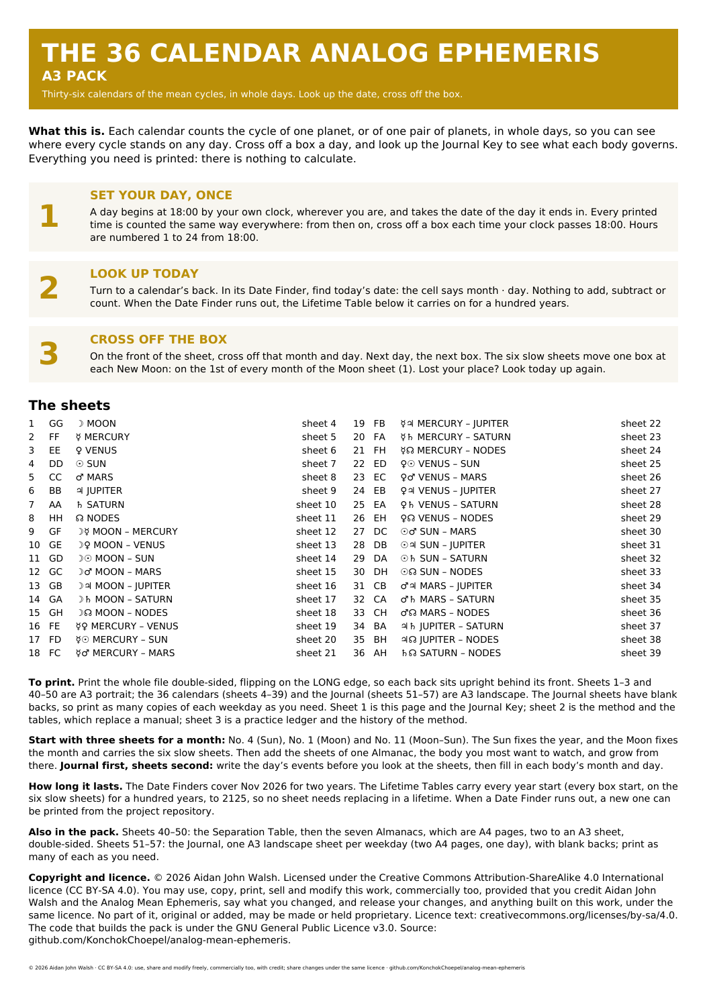
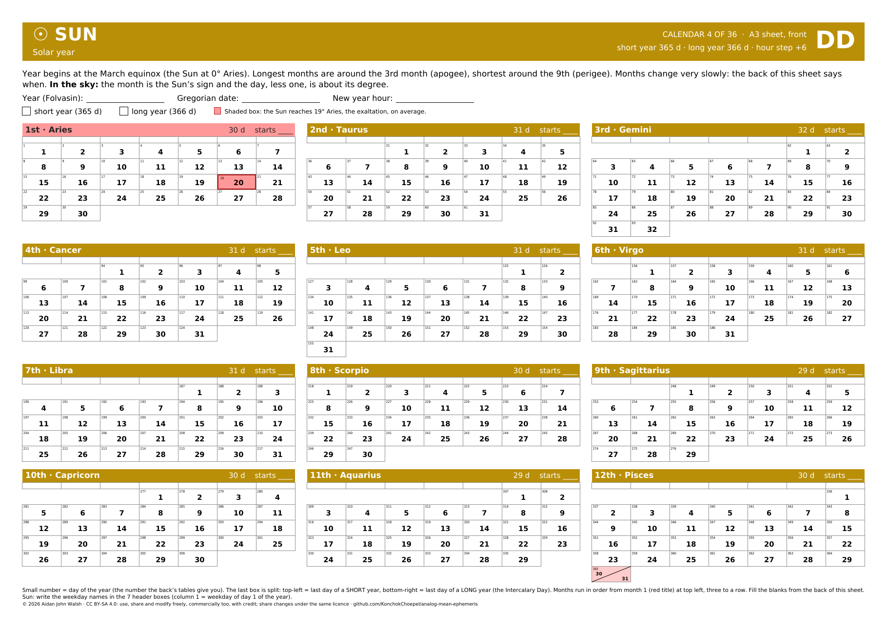
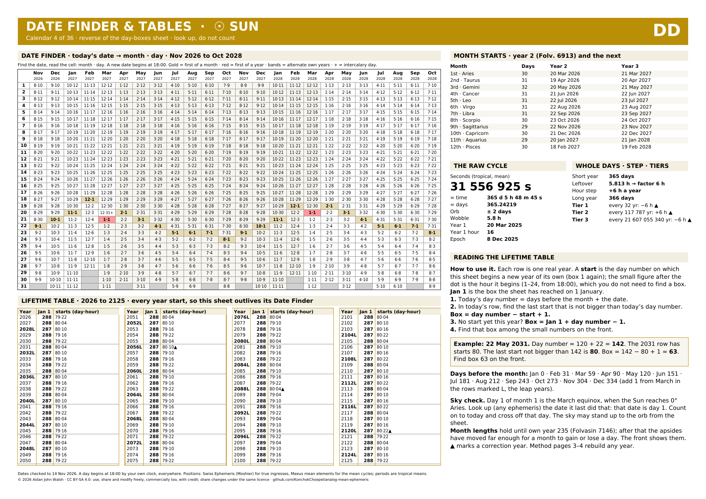
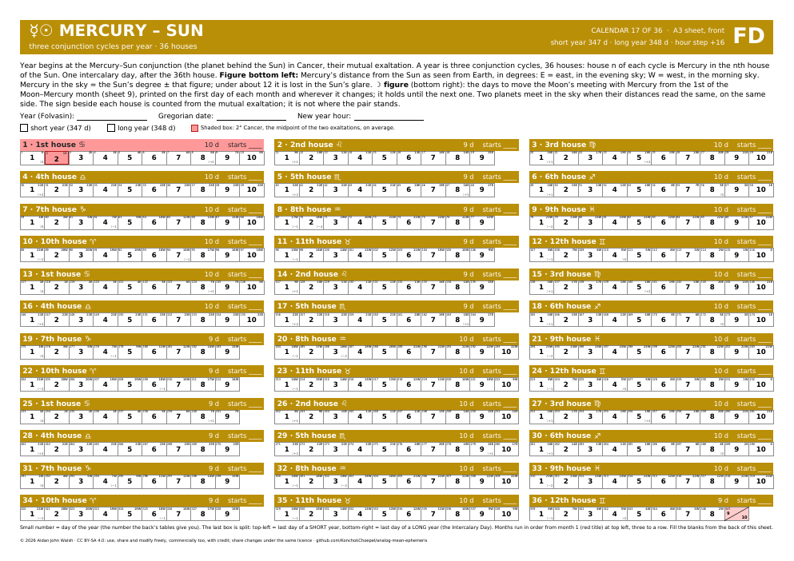
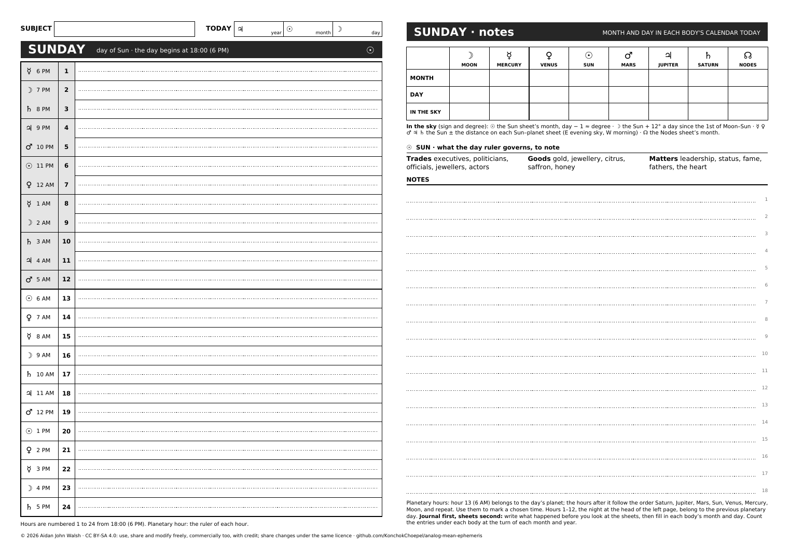

# The 36 Calendar Analog Ephemeris

**Every planetary cycle on paper, in whole days. Look up the date, cross off the box.**

By Aidan John Walsh.



Thirty-six calendars: the Moon, Mercury, Venus, the Sun, Mars, Jupiter, Saturn and the Lunar Nodes, and every pair of them. Each counts its mean cycle in whole days, with an intercalary day and a self-correcting hour step that keep it true for a lifetime. You cross off one box a day; the backs of the sheets tell you, without arithmetic, where every cycle stands on any date. The calendars exist to date an empirical journal, so that patterns can be counted from first principles, as the Babylonian astronomers counted them.

| A3 calendar, front | Its back: Date Finder and Lifetime Table |
|---|---|
|  |  |
| **Mercury–Sun: 36 houses, Mercury’s distance from the Sun and the Moon’s days** | **The journal** |
|  |  |

## Download

| File | What it is |
|---|---|
| [`The_36_Calendar_Analog_Ephemeris.pdf`](The_36_Calendar_Analog_Ephemeris.pdf) | **The A3 pack** (114 pages): cover and Journal Key, the method, a practice ledger and the history of the method, the 36 calendars (front: day boxes; back: Date Finder, Month Starts, raw cycle, corrections, 100-year Lifetime Table), the Separation Table, seven almanacs and the seven weekday journal sheets |
| [`36_Calendars_A4_BW.pdf`](36_Calendars_A4_BW.pdf) | **The A4 home set**: a two-page calibration guide (setting each sheet by counting from its year in progress, an ephemeris only to check; the rotating new year and corrections for every sheet), then the 36 calendars in black and white, for cheap home printing |
| [`The_36_Calendar_Analog_Ephemeris_A4_Journal_BW.pdf`](The_36_Calendar_Analog_Ephemeris_A4_Journal_BW.pdf) | The A4 journal, one sheet per weekday |
| [`What_the_proof_against_Astrology_might_look_like.pdf`](What_the_proof_against_Astrology_might_look_like.pdf) | One page: what a disproof would look like, and the use of the work regardless |
| [`One_Page_Introduction.pdf`](One_Page_Introduction.pdf) | One page that shows what this is |
| [`calendars.csv`](calendars.csv) | Every number of every sheet |
| [`empirical/`](empirical/) | **The Empirical Edition**: the same 36 calendars, day for day, with codes only (A–H for the cycles, a–l for the sectors) and no interpretation, for blind retrospective pattern analysis. A3 pack (104 pages, with an analysis protocol, closing with the essay), the A4 home set (calibration guide, calendars, the essay, and on the last sheet the key, to be cut off and sealed until the analysis is done), A4 journal page, CSV |

The digital files are free, always. Printed sets are available.

## How it works, in brief

- **One epoch:** the Saturn–Neptune conjunction of 8 Dec 2025, in Folvasin Year 6912. Year 0 is the March equinox of 4888 BCE.
- **Whole days:** a day begins at 18:00 by your own clock, everywhere, and takes the date of the day it ends in. Each cycle has a short year and a long year; the last box of the year is split to show both.
- **Corrections in tiers:** every year begins a fixed number of hours later than the last, on a factor of 24; up to three tiers of corrections, each equal to that factor, keep every sheet within a day of its mean cycle for tens of thousands of years.
- **Year markers:** a single body’s year begins as it enters the sign of its exaltation; a pair’s year begins at its conjunction in the sign of its mutual exaltation (the midpoint of the two exaltations).
- **Months:** a single body’s months are the twelve signs, sized from its real orbit; a pair’s months are the houses of the slower body that the faster one transits, each with its zodiac sign; the Nodes run backwards.
- **The visible sky:** the Sun sheet gives the Sun’s sign and degree; Moon–Sun gives the Moon’s phase and place (12° east of the Sun a day); every Sun–planet sheet prints the planet’s distance from the Sun as seen from Earth (east: evening sky, west: morning sky), so the planet in the sky is the Sun’s degree ± that figure, and a ☽ figure that moves each Moon–planet meeting to the day you will see it; Sun–Nodes marks the eclipse seasons. Checked against the sky for 2026–2035: the Moon’s meetings within a day 95–100% of the time, every eclipse in a marked box.
- **Slow sheets:** Jupiter, Saturn, the Nodes and their pairs count one box per New Moon, the 1st of every month of the Moon sheet.

[`SPECIFICATION.md`](SPECIFICATION.md) has the full rules.

## Build it yourself

Every page comes from one model, `src/engine2.py`, and nothing is edited by hand.

```bash
pip install -r requirements.txt          # numpy, reportlab, pyswisseph, pillow, pypdf (and the DejaVu fonts)
cd src
python3 engine2.py ../calendars.csv
python3 build_a3.py ../The_36_Calendar_Analog_Ephemeris.pdf
python3 build_calendars.py /tmp/cal.pdf && python3 build_guide.py /tmp/guide.pdf
python3 assemble.py a4 ../36_Calendars_A4_BW.pdf /tmp/guide.pdf /tmp/cal.pdf
python3 build_journal.py ../The_36_Calendar_Analog_Ephemeris_A4_Journal_BW.pdf
python3 build_essay.py ../What_the_proof_against_Astrology_might_look_like.pdf
python3 verify_a3.py ../The_36_Calendar_Analog_Ephemeris.pdf   # recounts all 26 316 Date Finder cells from the printed rules
# the Empirical Edition: the same engine with codes only
export AME_EDITION=empirical
python3 engine2.py ../empirical/calendars_empirical.csv
python3 build_a3.py /tmp/a3e.pdf
python3 assemble.py a3 ../empirical/The_36_Calendar_Analog_Ephemeris_Empirical_A3.pdf /tmp/a3e.pdf ../What_the_proof_against_Astrology_might_look_like.pdf
python3 build_calendars.py /tmp/cale.pdf && python3 build_guide_emp.py /tmp/guidee.pdf
python3 assemble.py a4 ../empirical/36_Calendars_Empirical_A4_BW.pdf /tmp/guidee.pdf /tmp/cale.pdf ../What_the_proof_against_Astrology_might_look_like.pdf
python3 build_journal.py ../empirical/Journal_Empirical_A4.pdf
```

When a Date Finder window runs out, reprint just the 36 calendar sheets with a new window:

```bash
python3 reprint_calendars.py 2028 11 Calendars_from_Nov_2028.pdf
```

Every push to this repository rebuilds both editions and runs the recount automatically (`.github/workflows/verify.yml`).

## Licence

© 2026 Aidan John Walsh. The calendars, tables, data and text are under [CC BY-SA 4.0](https://creativecommons.org/licenses/by-sa/4.0/). The code is under the [GNU GPL v3.0](https://www.gnu.org/licenses/gpl-3.0.html). You may use, copy, print, sell and modify this work, commercially too, if you credit Aidan John Walsh and the Analog Mean Ephemeris, say what you changed, and release your changes, and anything built on this work, under the same licence. No part of it, original or added, may be made or held proprietary. See [LICENSE](LICENSE).

